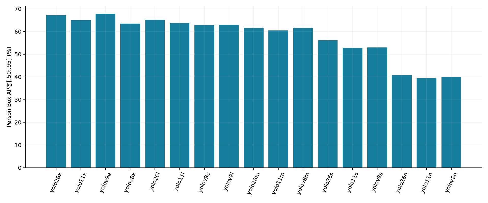
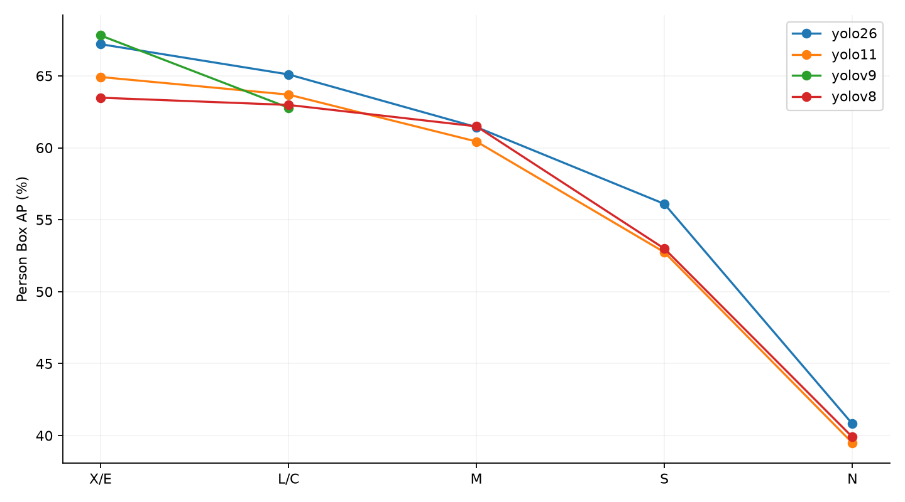
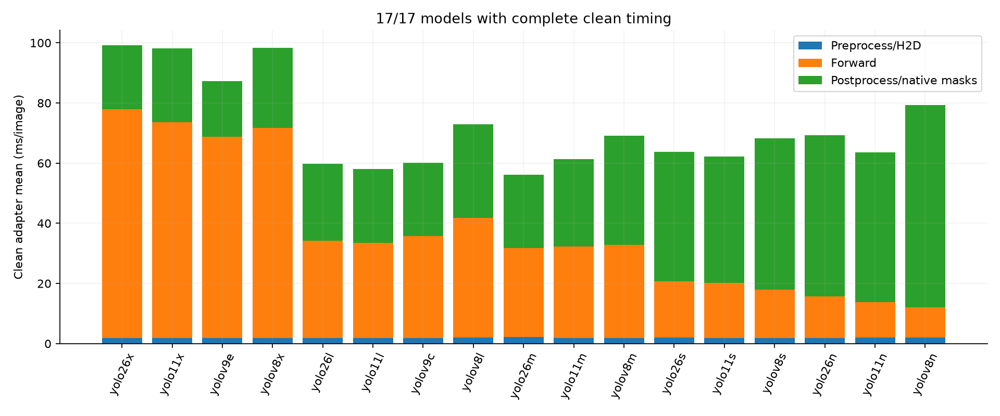

# สรุปสำหรับนำเสนอผล YOLO CCTV600

Run `cctv600-20261116T073208561699Z` · ตรวจปิดรอบเมื่อ 2026-11-16T16:13:20+07:00 (เวลาไทย)

คะแนนคุณภาพครบ **17/17 โมเดล × 600 ภาพ = 10,200 ผลรายภาพ** ผ่านการตรวจรับ เวลาหลักครบ **17/17 โมเดล**

**yolov9e-seg.pt ได้ Box AP สูงสุด 67.808%** สูงกว่า yolo26x-seg.pt 0.607 จุดเปอร์เซ็นต์ ส่วน Recall สูงสุดเป็น yolo26x-seg.pt ที่ 81.144%

## ข้อเสนอการเลือก

| เป้าหมาย | ตัวเลือกจากผลนี้ | สิ่งที่ต้องพิจารณา |
| --- | --- | --- |
| Box AP และ F1 | YOLOv9e-Seg | AP 67.808%, F1 85.356%, FP 53, FN 157 |
| เก็บคนให้ได้มากที่ confidence 0.25 | YOLO26x-Seg | Recall 81.144%, TP 624, FN 145, FP 113 |
| สมดุล AP กับ adapter time | YOLO26l-Seg | AP 65.099%, adapter mean 59.770 ms/ภาพ |
| คะแนนกลุ่ม M | YOLOv8m-Seg / YOLO26m-Seg | AP ต่างกันเพียง 0.052 จุดเปอร์เซ็นต์ ให้พิจารณา route และ resource ร่วม |
| คะแนนกลุ่ม S / N | YOLO26s-Seg / YOLO26n-Seg | นำ AP ในขนาดของตน แต่ Recall ต่ำกว่ารุ่นใหญ่ |

การเลือกข้างต้นอิงผล CCTV ชุดนี้ ต้องยืนยันกับข้อกำหนดระบบก่อน deployment ตารางใช้ pretrained checkpoint และ input 640 FP32 batch 1 บน Tesla T4 ค่า Box AP บอกคุณภาพกรอบตรวจคน ส่วน F1 ใช้ threshold ที่ตรึงไว้ก่อนรัน

## การเติมรอบเวลาและประวัติเดิม

เวลาหลักครบทั้ง 17 ตัวแล้ว ใช้ 47 clean rounds จาก run เดิม ร่วมกับ 4 clean rounds จาก segment `cctv600-timing-cont-20261116T090209308785Z` ตามการอนุมัติของผู้ใช้ รวม 51 รอบ × 100 ภาพ = 5,100 measured observations และ warmup ที่ตรวจรับ 510 calls

ส่วนที่เติมคือ YOLO26n รอบ 3, YOLO11n รอบ 2 และ 3, YOLOv8n รอบ 3 ใช้ภาพ ลำดับ input, checkpoint, environment, preprocessing, source, batch, FP32, guards และ timer เดิม เปลี่ยนเฉพาะ run ID/output path และคิว 4 รอบที่ขาด เก็บ manifest ระบุ compatibility และ hashes การเติมครั้งนี้ใช้ 400 measured calls กับ warmup 40 calls เพิ่มเติม ไม่มี quality calls

YOLO11n รอบ 2 เดิมเป็น `CONTAMINATED` มี 100 observations และ warmup 10 calls เก็บไว้ครบโดยตัดออกจากสถิติเวลาหลัก ค่าใช้จ่าย model calls ของ run หลักและ continuation รวมคุณภาพ 10,200 + timing ที่ตรวจรับ 5,610 + timing ที่ปนเปื้อน 110 = 15,920 calls

ผู้ใช้อนุมัติพักเฉพาะ worker เว็บ Body Extraction ชั่วคราว ตรวจแล้วไม่มีงาน RUNNING ก่อนพัก API และฐานข้อมูลคงทำงาน หลัง CUDA contexts เดิมคืนทรัพยากรจึงเปิด timing แบบ detached ใน tmux จากนั้นเปิด worker เว็บคืน หลักฐาน restoration เก็บแยก การตรวจ GPU ทุกช่วงที่ timer เดิมเก็บไว้ผ่านเกณฑ์ไม่มี external compute PID

Continuation จบเมื่อ 2026-11-16T16:04:39+07:00 (เวลาไทย) Original `COMPLETION.json` ที่เคยระบุ timing incomplete ยังคงเดิม สถานะรวมหลัง reconciliation อ่านจาก `metrics/CLOSEOUT.json` และ `metrics/RESULT_INDEX.json`

อ่านผลครบทั้ง 17 ตัว ตัวเลขต่อกลุ่ม และแหล่งหลักฐานใน [รายงานหลัก](MASTER_RESULTS.md) สูตรและความหมายอยู่ใน [คู่มือตัวชี้วัด](METRIC_GUIDE_TH.md)

## ขอบเขตการตีความ

คะแนนใช้ visible person bbox ที่ด้านยาวตั้งแต่ 50 px มี GT ที่เข้าเกณฑ์ 769 กรอบ คนเล็กอีก 5 กรอบและ ignore rectangles 172 รายการใช้เป็นพื้นที่ยกเว้น ฐานการรับรองว่าตรวจครบทุกคนมาจากการตรวจรับของผู้จัดทำ dataset ทั้ง 600 ภาพ ยังขาดการตรวจบัญชีบุคคลซ้ำอย่างอิสระครบทั้งชุด

โมเดลทุกตัวเป็น segmentation checkpoint แต่ GT รอบนี้รองรับคะแนนกรอบคน การประเมิน Person Mask AP ต้องมี GT silhouette รายคนเพิ่มเติม รูป mask ที่แสดงใน gallery ใช้ตรวจ output และ alignment เท่านั้น การเปรียบเทียบนี้ยังครอบคลุมเฉพาะ detector ไม่มีคะแนน human parsing สี่ส่วน สีเสื้อผ้า หรือ tracking

ทุกตัวใช้ input 640, FP32, batch 1 และตัวประเมินเดียวกัน แต่จำนวน parameters ข้อมูล pretraining และรายละเอียด checkpoint ต่างกัน ผลจึงอธิบาย checkpoint พร้อม application configuration บนชุด CCTV นี้ ประวัติ pretraining exposure ที่ตรวจยืนยันไม่ได้ยังเป็น unknown ข้อมูลบางส่วนเคยใช้พัฒนา annotation helper

ภาพจากกล้องหรือเหตุการณ์เดียวกันอาจสัมพันธ์กัน ยังไม่มี uncertainty หรือ significance analysis ส่วนต่างคะแนนและ near-tie เป็นผลเชิงพรรณนา ห้ามอ้างสาเหตุจาก architecture เพียงอย่างเดียวหรือรับรอง deployment จากชุดนี้

ตาราง MOTS20 เดิมวัด mask บนข้อมูลและ GT อีกแบบ การเทียบแนวโน้มต้องระบุ dataset และชนิด AP กำกับทุกครั้ง
