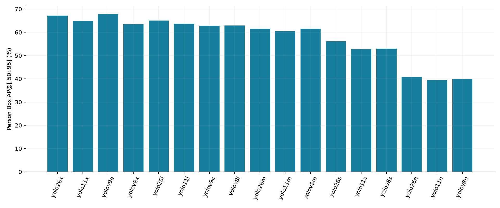
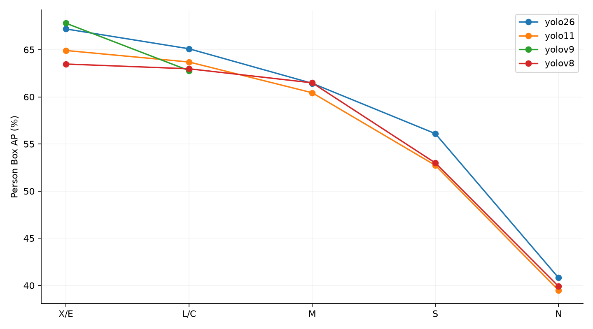
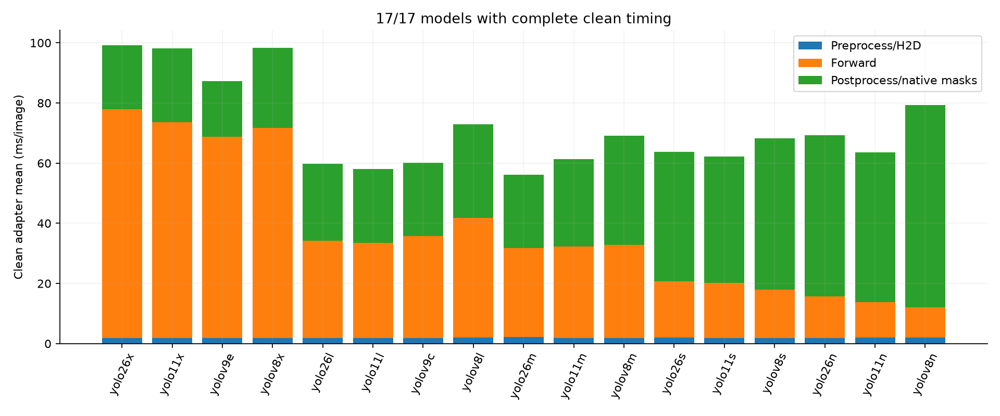
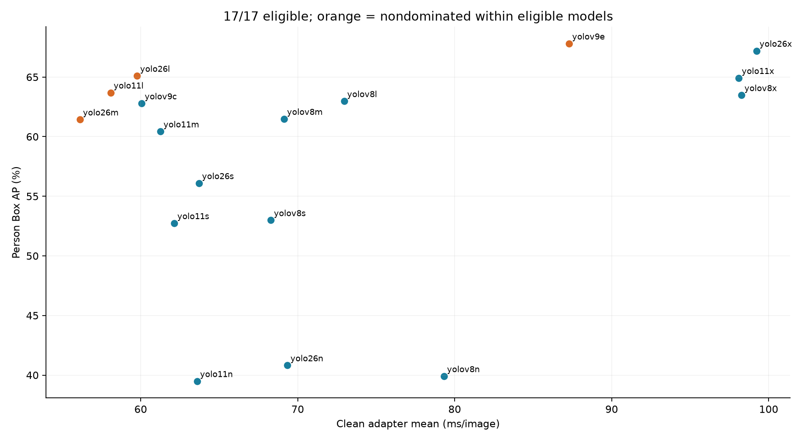
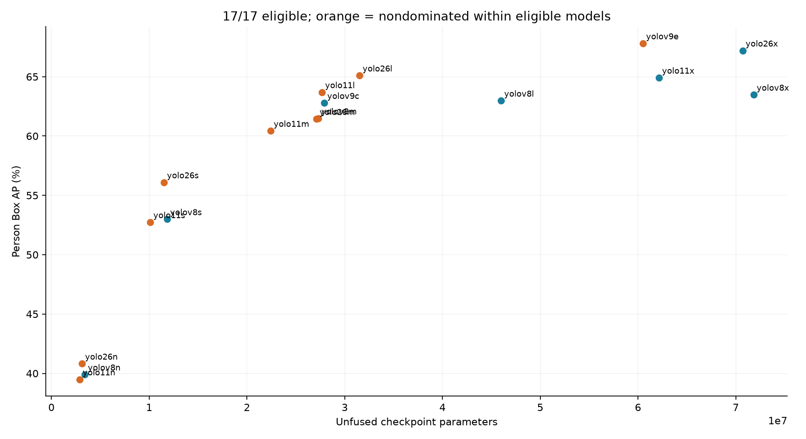
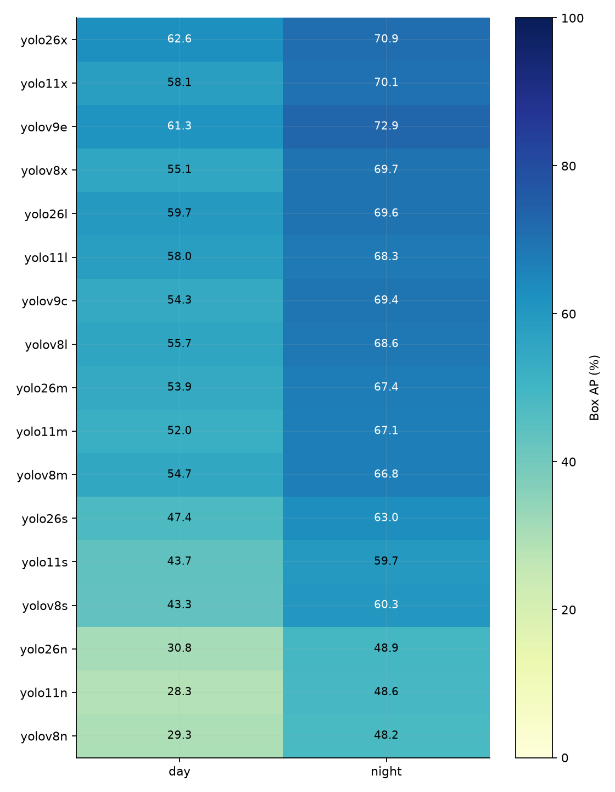
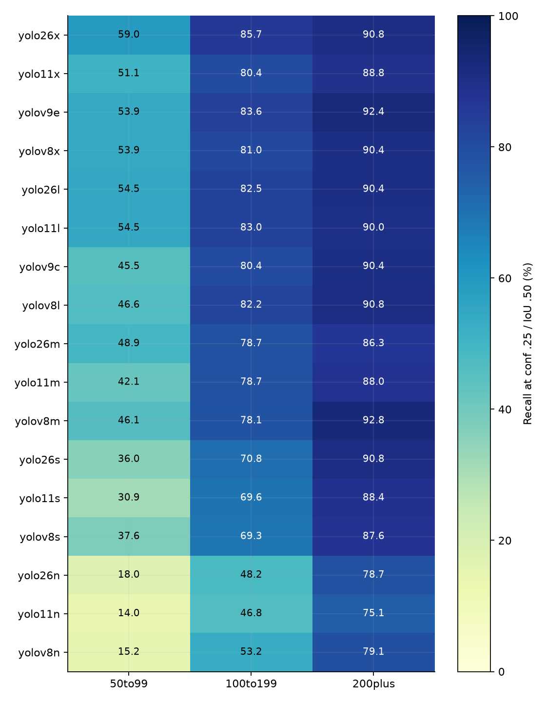

# ผลประเมิน YOLO บน CCTV Human Parsing 600

Run `cctv600-20261116T073208561699Z` · ตรวจปิดรอบเมื่อ 2026-11-16T16:13:20+07:00 (เวลาไทย)

คะแนนคุณภาพครบ **17/17 โมเดล × 600 ภาพ = 10,200 ผลรายภาพ** ผ่านการตรวจรับ เวลาหลักครบ **17/17 โมเดล**

**yolov9e-seg.pt ได้ Box AP สูงสุด 67.808%** สูงกว่า yolo26x-seg.pt 0.607 จุดเปอร์เซ็นต์ ส่วน Recall สูงสุดเป็น yolo26x-seg.pt ที่ 81.144%

## 1. สิ่งที่ทดสอบและตรวจปิดรอบ

ทดสอบ pretrained checkpoints 17 ตัวจาก YOLO26, YOLO11, YOLOv9 และ YOLOv8 แบ่งเป็น X/E → L/C → M → S → N ใช้ NVIDIA Tesla T4 จริง ไม่มี fine-tuning ในรอบ benchmark นี้ CPU acceptance ผ่านก่อนเปิดงาน ผูก config/source/checkpoint/environment ไว้ใน PREPARED และ LAUNCH

Environment ใช้ Python 3.12.3, PyTorch 2.14.0+cu130, torchvision 0.29.0+cu130, Ultralytics 8.4.160 และ pycocotools 2.0.11 ตรึง population SHA256 `d9a5cdc80d3b1f462125776e02c2ef1e87be1b881bdd3482e81d72fdaf25d6fc` และ scientific binding `aa621de9ab1ca797a8e103df3bfb21f87307fc436f4701da7b094df33e8a68eb` รายการ weights พร้อม SHA256 อยู่ใน [CHECKPOINTS.json](manifests/CHECKPOINTS.json)

งานเริ่ม 16 พฤศจิกายน 2026 เวลา 14:38:19 น. คุณภาพเขียน packet สุดท้ายเวลา 15:23:33 น. ตัวควบคุมจบรอบรวมเวลา 15:43:16 น. ทุกเวลาเป็นเวลาไทย ระยะเหล่านี้รวมงาน orchestration จึงแสดงแยกจากเวลาเฉลี่ยต่อภาพ

ตรวจ membership จากชื่อ packet จริงเทียบ population และ packet audit ทั้ง 17 ตัว อ่าน receipts ผูก hash ครบ 10,200 รายการ ตรวจ per-image CSV กับ TP/FP/FN/GT และ ledger ผล canonical ครบ 600 IDs ไม่ซ้ำต่อโมเดล missing/unexpected/invalid เป็น 0 ทั้งหมด นำ audit ที่ตรวจ readback และ saved-packet scoring แล้วกลับมาใช้ ตรวจ hash ใหม่เฉพาะไฟล์ที่ filesystem timestamps ใหม่กว่า audit พร้อมเก็บ hash ของ metrics/audit เพื่ออ้างย้อนกลับ

ตรวจ source/config binding เดิมผ่านก่อนสร้างรายงาน derived ไม่ได้เรียกโมเดลหรือ full rescore เพื่อจัดตาราง ตรวจ maxDet 200 เทียบ 1000 บน 100 ภาพเดิมผ่านทั้ง 17 ตัว ผลต่าง AP ทั้งสามค่าเป็นศูนย์

## 2. ผลคุณภาพรวม

ตารางเรียง frozen roster order ค่าต้นฉบับเก็บความละเอียดเต็มใน CSV แสดงผลนี้ปัดเศษสามตำแหน่ง P/R/F1 ใช้ confidence ≥0.25 และ bbox IoU ≥0.50 ส่วน Box AP ใช้ IoU 0.50 ถึง 0.95 ทีละ 0.05, 101 recall points, maxDet 200

| Model | Box AP % | AP50 % | AP75 % | P % | R % | F1 % | TP | FP | FN |
| --- | --- | --- | --- | --- | --- | --- | --- | --- | --- |
| yolo26x-seg.pt | 67.201 | 86.080 | 76.046 | 84.668 | 81.144 | 82.869 | 624 | 113 | 145 |
| yolo11x-seg.pt | 64.917 | 84.329 | 73.520 | 86.706 | 76.333 | 81.189 | 587 | 90 | 182 |
| yolov9e-seg.pt | 67.808 | 87.168 | 77.973 | 92.030 | 79.584 | 85.356 | 612 | 53 | 157 |
| yolov8x-seg.pt | 63.481 | 83.016 | 72.864 | 82.030 | 77.763 | 79.840 | 598 | 131 | 171 |
| yolo26l-seg.pt | 65.099 | 83.971 | 74.179 | 83.541 | 78.544 | 80.965 | 604 | 119 | 165 |
| yolo11l-seg.pt | 63.696 | 84.760 | 72.222 | 88.710 | 78.674 | 83.391 | 605 | 77 | 164 |
| yolov9c-seg.pt | 62.788 | 84.033 | 71.876 | 85.947 | 75.553 | 80.415 | 581 | 95 | 188 |
| yolov8l-seg.pt | 62.978 | 82.235 | 72.434 | 81.044 | 76.723 | 78.824 | 590 | 138 | 179 |
| yolo26m-seg.pt | 61.437 | 81.107 | 69.662 | 85.224 | 74.252 | 79.361 | 571 | 99 | 198 |
| yolo11m-seg.pt | 60.436 | 80.994 | 67.273 | 87.832 | 73.212 | 79.858 | 563 | 78 | 206 |
| yolov8m-seg.pt | 61.489 | 82.569 | 69.790 | 84.919 | 75.423 | 79.890 | 580 | 103 | 189 |
| yolo26s-seg.pt | 56.099 | 76.079 | 64.778 | 82.099 | 69.181 | 75.088 | 532 | 116 | 237 |
| yolo11s-seg.pt | 52.740 | 74.202 | 59.316 | 83.415 | 66.710 | 74.133 | 513 | 102 | 256 |
| yolov8s-seg.pt | 52.991 | 74.809 | 59.256 | 78.496 | 67.880 | 72.803 | 522 | 143 | 247 |
| yolo26n-seg.pt | 40.817 | 61.914 | 45.176 | 77.822 | 51.105 | 61.695 | 393 | 112 | 376 |
| yolo11n-seg.pt | 39.493 | 59.325 | 44.019 | 77.339 | 48.375 | 59.520 | 372 | 109 | 397 |
| yolov8n-seg.pt | 39.903 | 61.634 | 44.693 | 78.835 | 52.796 | 63.240 | 406 | 109 | 363 |

### ตัวชี้วัดประกอบและความซับซ้อน

| Model | AR@200 % | IoU เฉพาะ TP % | Parameters | GFLOPs estimate | Weights MB |
| --- | --- | --- | --- | --- | --- |
| yolo26x-seg.pt | 76.619 | 88.237 | 70,693,800 | 338.203 | 142.130 |
| yolo11x-seg.pt | 74.317 | 88.206 | 62,142,656 | 297.892 | 125.091 |
| yolov9e-seg.pt | 76.008 | 88.446 | 60,512,800 | 238.333 | 122.212 |
| yolov8x-seg.pt | 74.499 | 87.694 | 71,827,888 | 329.189 | 144.102 |
| yolo26l-seg.pt | 75.670 | 88.160 | 31,515,528 | 151.304 | 63.700 |
| yolo11l-seg.pt | 72.562 | 87.259 | 27,678,368 | 133.176 | 56.097 |
| yolov9c-seg.pt | 73.251 | 87.066 | 27,897,120 | 149.340 | 56.470 |
| yolov8l-seg.pt | 74.499 | 88.213 | 45,997,728 | 211.060 | 92.417 |
| yolo26m-seg.pt | 72.965 | 87.562 | 27,112,072 | 132.781 | 54.750 |
| yolo11m-seg.pt | 71.808 | 86.969 | 22,420,896 | 113.968 | 45.400 |
| yolov8m-seg.pt | 72.510 | 86.957 | 27,285,968 | 104.977 | 54.921 |
| yolo26s-seg.pt | 68.479 | 86.721 | 11,505,800 | 37.662 | 23.468 |
| yolo11s-seg.pt | 67.360 | 85.692 | 10,113,248 | 33.364 | 20.669 |
| yolov8s-seg.pt | 66.606 | 85.263 | 11,821,056 | 40.339 | 23.915 |
| yolo26n-seg.pt | 59.025 | 84.139 | 3,126,280 | 10.630 | 6.720 |
| yolo11n-seg.pt | 59.207 | 84.234 | 2,876,848 | 9.959 | 6.183 |
| yolov8n-seg.pt | 59.441 | 83.189 | 3,409,968 | 12.141 | 7.072 |

AR เฉลี่ย maximum recall ข้าม IoU 10 ระดับ ส่วน IoU เฉพาะ TP เฉลี่ยบนคู่ที่จับสำเร็จที่ operating point เดิม จึงต้องอ่านควบคู่กับ Recall ของแต่ละตัว นิยาม หน่วย และแหล่งคำนวณอธิบายใน [คู่มือตัวชี้วัด](METRIC_GUIDE_TH.md)

## 3. ผลตามขนาดและการเลือกโมเดล

| กลุ่ม | Box AP สูงสุด | AP % | ห่างอันดับสอง pp |
| --- | --- | --- | --- |
| largest | yolov9e-seg.pt | 67.808 | 0.607 |
| second_largest | yolo26l-seg.pt | 65.099 | 1.403 |
| medium | yolov8m-seg.pt | 61.489 | 0.052 |
| small | yolo26s-seg.pt | 56.099 | 3.108 |
| nano | yolo26n-seg.pt | 40.817 | 0.914 |

YOLOv9e มี TP 612 / FP 53 / FN 157 ที่ operating point เดิม เทียบกับ YOLO26x ที่ TP 624 / FP 113 / FN 145 จึงมีข้อแลกเปลี่ยนระหว่างการเก็บคนและ false positives

ในกลุ่ม M ค่า AP ของ YOLOv8m สูงกว่า YOLO26m เพียง 0.052 จุดเปอร์เซ็นต์ การเรียกว่าชนะอย่างมีนัยสำคัญต้องมีหลักฐานเพิ่ม ตัวอย่าง near-tie ทั้งหมดอยู่ใน [ตาราง near-tie](metrics/NEAR_TIES.csv) เกณฑ์ส่วนต่างไม่เกิน 0.1 จุดเปอร์เซ็นต์ใช้เพื่อชี้คู่ที่ควรอ่านรายละเอียด

ตาราง [การลดขนาด 13 คู่](metrics/SCALING_DELTAS.csv) คำนวณ smaller − larger จากสถิติเต็มก่อนปัดเศษ ทั้งค่า accuracy จุดเปอร์เซ็นต์และต้นทุนสัมพัทธ์ ตรวจว่าค่า accuracy และเวลาของทั้ง 13 คู่มีแหล่งผลครบแล้ว

การลดขนาดทั้ง 13 คู่ทำให้ AP และ forward time ลดลง แต่ adapter time เพิ่มใน 6 คู่ และ allocated peak เพิ่มใน 6 คู่ ข้อมูลนี้แสดงว่าชื่อขนาดกับเวลา/หน่วยความจำของ native-mask pipeline ไม่ได้เรียงตามกันเสมอ ต้องพิจารณา postprocessing และ retained outputs ร่วมด้วย การระบุสาเหตุที่แน่นอนต้องมี diagnostic เพิ่ม

ข้อเสนอเบื้องต้นจากข้อมูลชุดนี้คือ YOLOv9e สำหรับ Box AP และ F1, YOLO26x สำหรับ Recall และ YOLO26l สำหรับสมดุล AP กับ adapter time ในกลุ่มที่จับเวลาครบ ทั้งสามยังต้องตรวจความเหมาะสมกับงานจริง ไม่มีคะแนนถ่วงน้ำหนักรวมใหม่

## 4. ความเร็วและทรัพยากร

| Model | Clean rounds | Forward ms/ภาพ | Adapter ms/ภาพ | Adapter FPS | Allocated MiB |
| --- | --- | --- | --- | --- | --- |
| yolo26x-seg.pt | 3/3 | 76.028 | 99.223 | 10.078 | 702.673 |
| yolo11x-seg.pt | 3/3 | 71.704 | 98.090 | 10.195 | 737.890 |
| yolov9e-seg.pt | 3/3 | 66.884 | 87.289 | 11.456 | 737.590 |
| yolov8x-seg.pt | 3/3 | 69.740 | 98.263 | 10.177 | 791.839 |
| yolo26l-seg.pt | 3/3 | 32.419 | 59.770 | 16.731 | 671.182 |
| yolo11l-seg.pt | 3/3 | 31.570 | 58.082 | 17.217 | 727.638 |
| yolov9c-seg.pt | 3/3 | 33.930 | 60.060 | 16.650 | 506.215 |
| yolov8l-seg.pt | 3/3 | 39.798 | 72.958 | 13.707 | 686.878 |
| yolo26m-seg.pt | 3/3 | 29.719 | 56.126 | 17.817 | 605.934 |
| yolo11m-seg.pt | 3/3 | 30.418 | 61.257 | 16.325 | 696.762 |
| yolov8m-seg.pt | 3/3 | 30.927 | 69.127 | 14.466 | 766.317 |
| yolo26s-seg.pt | 3/3 | 18.766 | 63.711 | 15.696 | 781.328 |
| yolo11s-seg.pt | 3/3 | 18.279 | 62.138 | 16.093 | 676.367 |
| yolov8s-seg.pt | 3/3 | 15.972 | 68.290 | 14.643 | 1094.403 |
| yolo26n-seg.pt | 3/3 | 13.818 | 69.345 | 14.421 | 1344.222 |
| yolo11n-seg.pt | 3/3 | 11.861 | 63.587 | 15.727 | 804.799 |
| yolov8n-seg.pt | 3/3 | 9.923 | 79.317 | 12.608 | 1154.993 |

### องค์ประกอบและการกระจายของเวลาที่ตรวจรับ

| Model | Pre mean ms | Forward mean ms | Post mean ms | Adapter median ms | Adapter P95 ms | Adapter std ms | Reserved MiB |
| --- | --- | --- | --- | --- | --- | --- | --- |
| yolo26x-seg.pt | 1.884 | 76.028 | 21.312 | 91.791 | 137.042 | 19.377 | 924.000 |
| yolo11x-seg.pt | 1.910 | 71.704 | 24.475 | 91.360 | 139.101 | 19.703 | 1444.000 |
| yolov9e-seg.pt | 1.958 | 66.884 | 18.446 | 82.202 | 116.488 | 15.023 | 1156.000 |
| yolov8x-seg.pt | 1.960 | 69.740 | 26.563 | 93.476 | 131.799 | 19.427 | 1414.000 |
| yolo26l-seg.pt | 1.835 | 32.419 | 25.515 | 52.419 | 105.924 | 23.022 | 1296.000 |
| yolo11l-seg.pt | 1.876 | 31.570 | 24.636 | 50.077 | 108.010 | 21.926 | 1236.000 |
| yolov9c-seg.pt | 1.897 | 33.930 | 24.233 | 53.830 | 95.997 | 19.065 | 960.000 |
| yolov8l-seg.pt | 2.037 | 39.798 | 31.123 | 65.687 | 118.441 | 22.959 | 1026.000 |
| yolo26m-seg.pt | 2.134 | 29.719 | 24.274 | 49.502 | 96.780 | 21.145 | 1036.000 |
| yolo11m-seg.pt | 1.897 | 30.418 | 28.943 | 54.130 | 113.996 | 24.967 | 1086.000 |
| yolov8m-seg.pt | 1.924 | 30.927 | 36.275 | 60.741 | 134.142 | 29.670 | 1248.000 |
| yolo26s-seg.pt | 2.034 | 18.766 | 42.910 | 50.844 | 139.199 | 38.263 | 1188.000 |
| yolo11s-seg.pt | 1.955 | 18.279 | 41.905 | 51.378 | 132.056 | 33.791 | 1986.000 |
| yolov8s-seg.pt | 1.927 | 15.972 | 50.391 | 51.205 | 154.578 | 47.315 | 1716.000 |
| yolo26n-seg.pt | 1.953 | 13.818 | 53.574 | 54.262 | 150.075 | 56.420 | 1562.000 |
| yolo11n-seg.pt | 1.962 | 11.861 | 49.764 | 51.701 | 161.851 | 44.890 | 1016.000 |
| yolov8n-seg.pt | 2.069 | 9.923 | 67.324 | 65.365 | 197.979 | 57.091 | 1616.000 |

เวลาหลักใช้ 100 ภาพเดิม × 3 รอบที่ผ่านเกณฑ์ รวม 300 measured observations ต่อโมเดล หลัง warmup 10 ภาพต่อรอบ Forward คือ model call ภายใน adapter ส่วน adapter รวม preprocessing/H2D, forward และ postprocessing/native masks/compact transfer Input read/decode, RLE, packet write, load, warmup และเวลารอคิวแยกออกมา FPS = 1000 / mean adapter ms

Mean, median, P95 และ population std อยู่ใน [TIMING_MASTER.csv](metrics/TIMING_MASTER.csv) รวมรายละเอียด native postprocessing ย่อยที่ timer เดิมเก็บไว้ Substage ที่อยู่ภายใน postprocessing ห้ามบวกซ้ำเข้ารวม pipeline

ใน 17 ตัวที่เวลาครบ yolo26m-seg.pt มี adapter mean ต่ำสุด 56.126 ms/ภาพ (17.817 FPS) ส่วน forward ต่ำสุดอาจเป็นคนละตัว ภาพ input และจำนวน masks ทำให้ต้นทุน postprocessing ต่างกัน ข้อมูลนี้ยังแยกสาเหตุทาง architecture ไม่ได้

ค่า peak allocated/reserved ใช้ค่าสูงสุดของสาม clean rounds หลัง reset peak เมื่อจบ warmup รวม resident model ด้วย ค่านี้แยกจาก VRAM รวมที่ nvidia-smi เห็น Checkpoint MB ใช้ฐาน 10^6, MiB ใช้ 2^20, parameters เป็นจำนวนก่อน fusion และ GFLOPs เป็นค่าประมาณที่ input 640 จาก exact checkpoint เดียวกับงาน MOTS20

เวลางานจริง 600 ภาพอยู่ใน [ACTIVE_600_TIMING.csv](metrics/ACTIVE_600_TIMING.csv) มีผลรวมวินาที ค่าเฉลี่ยต่อภาพ และ coverage ของแต่ละ stage รวม cold/session effects ค่า application เป็นช่วงอ่านภาพจนเขียน prediction packet สำเร็จ ห้ามนำ adapter time ไปบวก application ซ้ำ หรือเรียกผลรวมช่วงทำงานว่า elapsed wall time ของทั้งการทดลอง

## การเติมรอบเวลาและประวัติเดิม

เวลาหลักครบทั้ง 17 ตัวแล้ว ใช้ 47 clean rounds จาก run เดิม ร่วมกับ 4 clean rounds จาก segment `cctv600-timing-cont-20261116T090209308785Z` ตามการอนุมัติของผู้ใช้ รวม 51 รอบ × 100 ภาพ = 5,100 measured observations และ warmup ที่ตรวจรับ 510 calls

ส่วนที่เติมคือ YOLO26n รอบ 3, YOLO11n รอบ 2 และ 3, YOLOv8n รอบ 3 ใช้ภาพ ลำดับ input, checkpoint, environment, preprocessing, source, batch, FP32, guards และ timer เดิม เปลี่ยนเฉพาะ run ID/output path และคิว 4 รอบที่ขาด เก็บ manifest ระบุ compatibility และ hashes การเติมครั้งนี้ใช้ 400 measured calls กับ warmup 40 calls เพิ่มเติม ไม่มี quality calls

YOLO11n รอบ 2 เดิมเป็น `CONTAMINATED` มี 100 observations และ warmup 10 calls เก็บไว้ครบโดยตัดออกจากสถิติเวลาหลัก ค่าใช้จ่าย model calls ของ run หลักและ continuation รวมคุณภาพ 10,200 + timing ที่ตรวจรับ 5,610 + timing ที่ปนเปื้อน 110 = 15,920 calls

ผู้ใช้อนุมัติพักเฉพาะ worker เว็บ Body Extraction ชั่วคราว ตรวจแล้วไม่มีงาน RUNNING ก่อนพัก API และฐานข้อมูลคงทำงาน หลัง CUDA contexts เดิมคืนทรัพยากรจึงเปิด timing แบบ detached ใน tmux จากนั้นเปิด worker เว็บคืน หลักฐาน restoration เก็บแยก การตรวจ GPU ทุกช่วงที่ timer เดิมเก็บไว้ผ่านเกณฑ์ไม่มี external compute PID

Continuation จบเมื่อ 2026-11-16T16:04:39+07:00 (เวลาไทย) Original `COMPLETION.json` ที่เคยระบุ timing incomplete ยังคงเดิม สถานะรวมหลัง reconciliation อ่านจาก `metrics/CLOSEOUT.json` และ `metrics/RESULT_INDEX.json`

## 5. ผลตามบริบทและขนาดคน

| Model | Day AP % | Night AP % | R 50–99 px % | R 100–199 px % | R ≥200 px % |
| --- | --- | --- | --- | --- | --- |
| yolo26x-seg.pt | 62.582 | 70.873 | 58.989 | 85.673 | 90.763 |
| yolo11x-seg.pt | 58.086 | 70.065 | 51.124 | 80.409 | 88.755 |
| yolov9e-seg.pt | 61.297 | 72.883 | 53.933 | 83.626 | 92.369 |
| yolov8x-seg.pt | 55.143 | 69.743 | 53.933 | 80.994 | 90.361 |
| yolo26l-seg.pt | 59.651 | 69.628 | 54.494 | 82.456 | 90.361 |
| yolo11l-seg.pt | 57.962 | 68.283 | 54.494 | 83.041 | 89.960 |
| yolov9c-seg.pt | 54.252 | 69.406 | 45.506 | 80.409 | 90.361 |
| yolov8l-seg.pt | 55.732 | 68.569 | 46.629 | 82.164 | 90.763 |
| yolo26m-seg.pt | 53.936 | 67.426 | 48.876 | 78.655 | 86.345 |
| yolo11m-seg.pt | 51.992 | 67.059 | 42.135 | 78.655 | 87.952 |
| yolov8m-seg.pt | 54.731 | 66.820 | 46.067 | 78.070 | 92.771 |
| yolo26s-seg.pt | 47.416 | 62.999 | 35.955 | 70.760 | 90.763 |
| yolo11s-seg.pt | 43.714 | 59.741 | 30.899 | 69.591 | 88.353 |
| yolov8s-seg.pt | 43.310 | 60.311 | 37.640 | 69.298 | 87.550 |
| yolo26n-seg.pt | 30.775 | 48.934 | 17.978 | 48.246 | 78.715 |
| yolo11n-seg.pt | 28.288 | 48.634 | 14.045 | 46.784 | 75.100 |
| yolov8n-seg.pt | 29.323 | 48.163 | 15.169 | 53.216 | 79.116 |

Day 243 ภาพ / GT 349 คน และ night 357 ภาพ / GT 420 คน ใช้ metadata ที่มีอยู่ การแยกนี้ยังไม่ควบคุม scene, camera หรือความยากให้เท่ากัน AP รวม 600 ภาพคำนวณแบบ pooled จาก ranking เดียว ค่าเฉลี่ยของ day/night AP ใช้แทน pooled AP ไม่ได้

กลุ่มด้านยาว GT 50–99 px มี 178 คน, 100–199 px มี 342 คน และ ≥200 px มี 249 คน ตารางรายงาน Recall จาก matching เดิมโดยนับ GT ที่อยู่ในช่วงนั้น ไม่ได้คำนวณ AP หรือ Precision ต่อ size band เพราะยังไม่ได้กำหนดการแจก FP ลงช่วงขนาด

## 6. ภาพเปรียบเทียบ

ใช้ fixed sample 16 ภาพที่กำหนดก่อนเห็นผล ทั้งห้า tiers ใช้ IDs เดียวกัน มี 80 comparison panels ตรวจ manifest/model membership และขนาดไฟล์ภาพครบ ตรวจด้วยสายตาบนภาพลำดับ 1 และ 3 ข้ามห้า tiers รวม 10 panels ภาพลำดับ 1 เห็นคนใกล้ขอบภาพกับคนไกลในแนวบันได ผลของโมเดลต่อคนไกลต่างกัน ภาพลำดับ 3 เห็นบุคคลถูกตัดด้วยขอบเฟรม การเปรียบเทียบทั้งสองเป็นตัวอย่าง output ไม่ใช้รับรองความถูกต้องของขอบ mask ทั้งชุด

ภาพต้นฉบับและ gallery มีข้อมูล CCTV ส่วนบุคคล จัดเก็บในเครื่อง เปิดจาก `outputs/<run_id>/gallery/index.html` ของแต่ละ tier หรือเปิด [ดัชนีในเครื่อง](outputs/cctv600-20261116T073208561699Z/closeout/index.html) ซึ่งรวมลิงก์ทั้งห้ากลุ่ม ไฟล์ภาพชุดนี้เก็บตามนโยบาย private ส่วนกราฟรวมใน Git เปิดดูได้โดยตรง

## 7. การจัดผลตามงาน MOTS20

| ส่วน | ผลส่งมอบ CCTV600 |
| --- | --- |
| ตารางหลักและผู้ชนะรายขนาด | MASTER_17_MODELS.csv และ TIER_WINNERS.csv |
| AP / P / R / F1 / TP / FP / FN / IoU / AR | ตารางหลักและคู่มือนิยามตัวชี้วัด |
| PR / F1-confidence curves | กราฟเดิมราย tier จาก saved predictions |
| Scaling / near ties | 13 adjacent pairs และคู่ AP ต่างกันไม่เกิน 0.1 pp |
| Forward / pipeline / VRAM Pareto | ตารางและกราฟเฉพาะ 17 โมเดลเวลาครบ |
| Stage timing / complexity | Mean / median / P95 / std, parameters, GFLOPs, MB |
| ผลตามกลุ่มข้อมูล | Day/night AP และ Recall ตามขนาด GT |
| ภาพจริง | Fixed sample 16 ภาพทุก tier เก็บ private |
| Provenance / closure | RESULT_INDEX.json และ CLOSEOUT.json |

## 8. ไฟล์สำหรับตรวจต่อ

- [บทสรุปเพื่อเลือกโมเดล](EXECUTIVE_SUMMARY_TH.md)
- [นิยามตัวชี้วัด สูตร ขอบเขตเวลา และ schema ตาราง](METRIC_GUIDE_TH.md)
- [ตารางรวมความละเอียดเต็ม](metrics/MASTER_17_MODELS.csv)
- [สถานะและ hashes ของผลที่ตรวจรับ](metrics/RESULT_INDEX.json)
- [ผลตรวจปิดรอบ](metrics/CLOSEOUT.json)
- [Protocol ที่ใช้รัน](EXPERIMENT_PROTOCOL.md)

## ขอบเขตการตีความ

คะแนนใช้ visible person bbox ที่ด้านยาวตั้งแต่ 50 px มี GT ที่เข้าเกณฑ์ 769 กรอบ คนเล็กอีก 5 กรอบและ ignore rectangles 172 รายการใช้เป็นพื้นที่ยกเว้น ฐานการรับรองว่าตรวจครบทุกคนมาจากการตรวจรับของผู้จัดทำ dataset ทั้ง 600 ภาพ ยังขาดการตรวจบัญชีบุคคลซ้ำอย่างอิสระครบทั้งชุด

โมเดลทุกตัวเป็น segmentation checkpoint แต่ GT รอบนี้รองรับคะแนนกรอบคน การประเมิน Person Mask AP ต้องมี GT silhouette รายคนเพิ่มเติม รูป mask ที่แสดงใน gallery ใช้ตรวจ output และ alignment เท่านั้น การเปรียบเทียบนี้ยังครอบคลุมเฉพาะ detector ไม่มีคะแนน human parsing สี่ส่วน สีเสื้อผ้า หรือ tracking

ทุกตัวใช้ input 640, FP32, batch 1 และตัวประเมินเดียวกัน แต่จำนวน parameters ข้อมูล pretraining และรายละเอียด checkpoint ต่างกัน ผลจึงอธิบาย checkpoint พร้อม application configuration บนชุด CCTV นี้ ประวัติ pretraining exposure ที่ตรวจยืนยันไม่ได้ยังเป็น unknown ข้อมูลบางส่วนเคยใช้พัฒนา annotation helper

ภาพจากกล้องหรือเหตุการณ์เดียวกันอาจสัมพันธ์กัน ยังไม่มี uncertainty หรือ significance analysis ส่วนต่างคะแนนและ near-tie เป็นผลเชิงพรรณนา ห้ามอ้างสาเหตุจาก architecture เพียงอย่างเดียวหรือรับรอง deployment จากชุดนี้

ตาราง MOTS20 เดิมวัด mask บนข้อมูลและ GT อีกแบบ การเทียบแนวโน้มต้องระบุ dataset และชนิด AP กำกับทุกครั้ง
