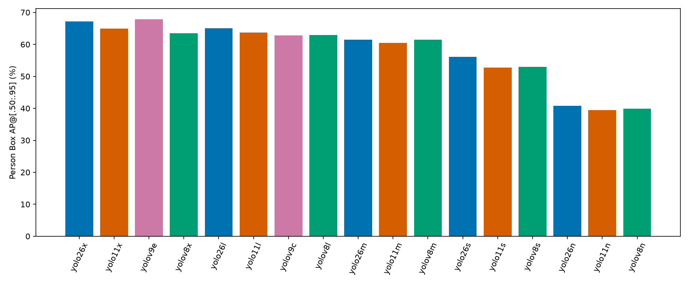
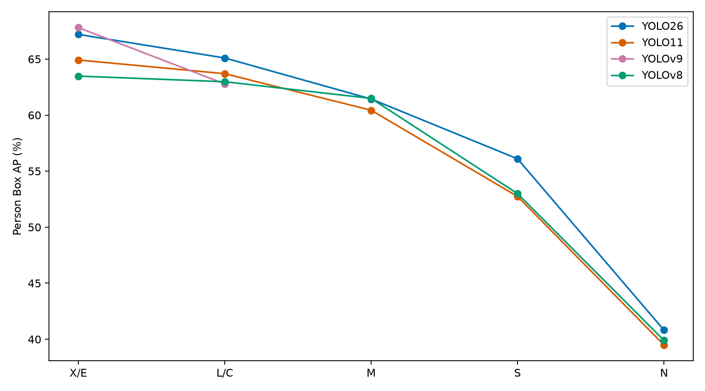
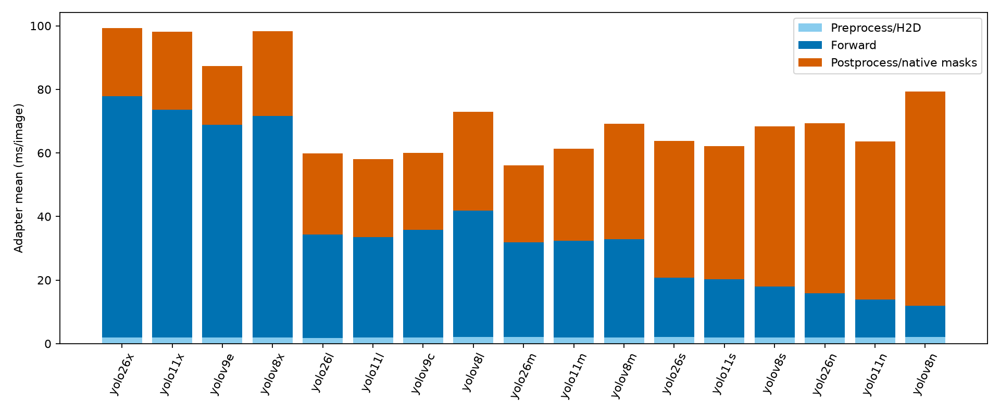
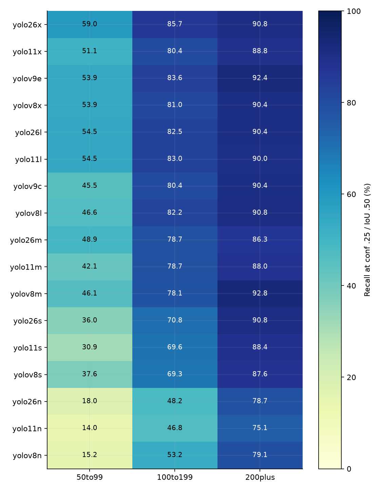

# สรุปสำหรับนำเสนอ YOLO CCTV600

## 1. ทดสอบอะไร

ครบ 17 checkpoints ตัวละ 600 ภาพ GT เข้าเกณฑ์ 769 คน พร้อม 3 clean timing rounds ต่อโมเดล ใช้ pretrained, input 640, batch 1, FP32 บน Tesla T4 คะแนนหลักเป็น visible person Box AP ของคนด้านยาวตั้งแต่ 50 px

## 2. ผลรวม 17 โมเดล

## 3. ใครนำแต่ละด้าน

| ด้าน | โมเดล | ค่าที่วัด |
| --- | --- | --- |
| Box AP | yolov9e-seg.pt | 67.808 % |
| AP75 | yolov9e-seg.pt | 77.973 % |
| Recall | yolo26x-seg.pt | 81.144 % |
| Forward time | yolov8n-seg.pt | 9.923 ms/ภาพ |
| Adapter time | yolo26m-seg.pt | 56.126 ms/ภาพ |
| Adapter FPS | yolo26m-seg.pt | 17.817 ภาพ/วินาที |
| Allocated VRAM | yolov9c-seg.pt | 506.215 MiB |

## 4. ลดขนาดแล้วต้นทุนเปลี่ยนอย่างไร

YOLO26x → l เปลี่ยน AP -2.102 pp แลก forward -57.36% และ adapter -39.76% ดู 13 คู่เต็มใน SCALING_DELTAS.csv

## 5. ทำไมต้องแยก forward กับ adapter

Forward ต่ำสุดคือ yolov8n-seg.pt แต่ adapter ต่ำสุดคือ yolo26m-seg.pt เพราะ timer ครอบคลุมงานหลัง model forward ด้วย ค่าเหล่านี้ใช้ขอบเขตที่ระบุในคู่มือตัวชี้วัด

## 6. ขนาดคนและฉากมีผลอย่างไร

ขนาด GT เป็นช่วง 50–99, 100–199 และ ≥200 px มี 178, 342 และ 249 คน การแยกกลุ่มอธิบายว่าคนช่วงใดถูกเก็บได้มากน้อยต่างกัน ส่วนการระบุว่าเกิดจากแสงหรือมุมกล้องต้องมีหลักฐานควบคุมเพิ่ม

## 7. ภาพตัวอย่างช่วยตอบอะไร

รายงานภาพราย tier ใช้สี่กรณีจาก fixed16 เดิม มีทั้งคนถูกตัดขอบ การบดบัง หลายขนาด/ignore และภาพไม่มี eligible GT ตรวจ counts และ matching จาก saved outputs ไม่มี model calls เพิ่มจากงานเอกสารนี้ ภาพอยู่ private พร้อมดัชนีในเครื่อง

## 8. ข้อเสนอการเลือก

พิจารณา YOLOv9e เมื่อเน้น AP/F1, YOLO26x เมื่อเน้น Recall และ YOLO26l เมื่อยอมลด AP เพื่อ adapter time ที่ต่ำลง ตัวเลือกนี้อิง CCTV600 ที่ตรวจรับอยู่ ต้องตรวจข้อกำหนดระบบก่อน deployment

## 9. ข้อจำกัดและสถานะ

ครบคุณภาพและเวลาทั้ง 17 โมเดลแล้ว GT รองรับคะแนนกรอบคน Person Mask AP ยังต้องมี GT silhouette เพิ่ม ยังไม่มี uncertainty หรือข้อสรุปสาเหตุทาง architecture งานนี้จบที่สรุปผลจากหลักฐานเดิม

[รายละเอียดวิจัย](RESEARCH_INSIGHTS_TH.md) · [ผลและ provenance](MASTER_RESULTS.md) · [สูตร metric](METRIC_GUIDE_TH.md)
