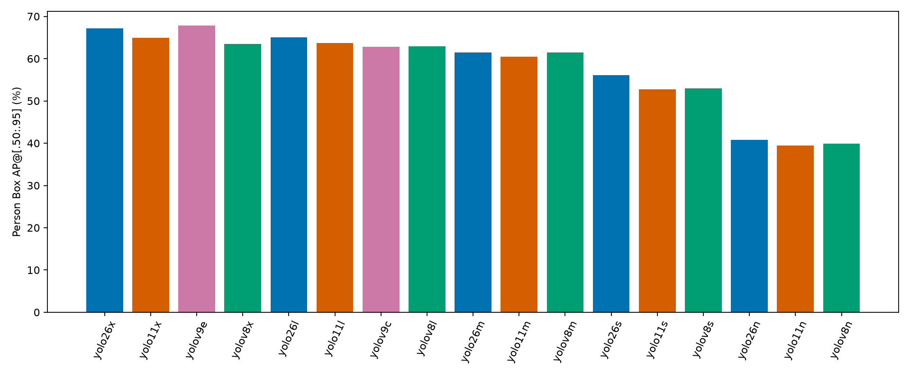
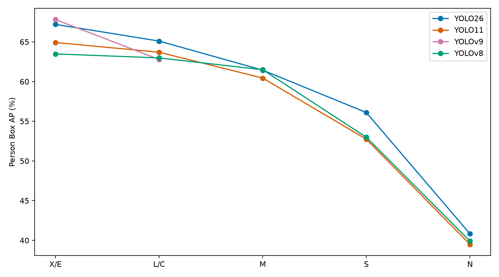
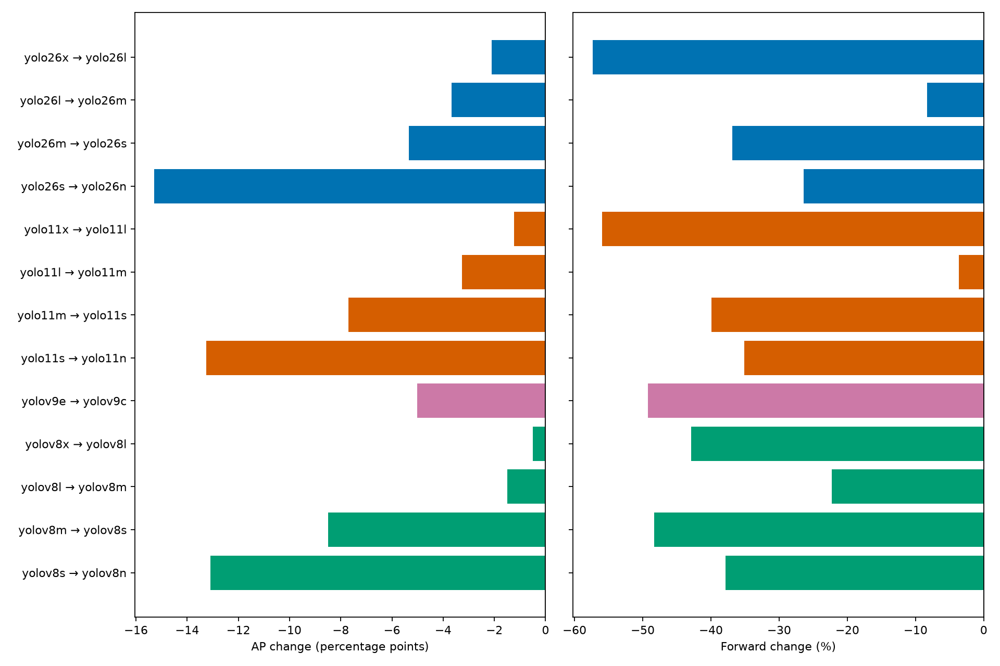
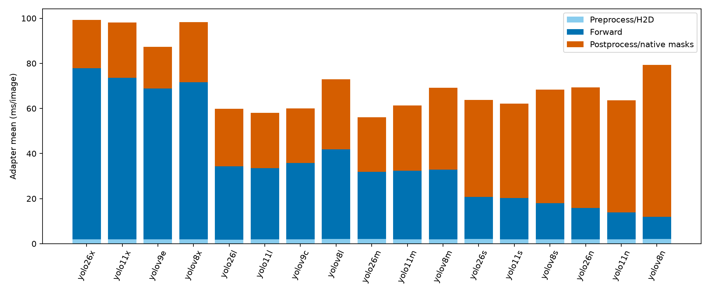
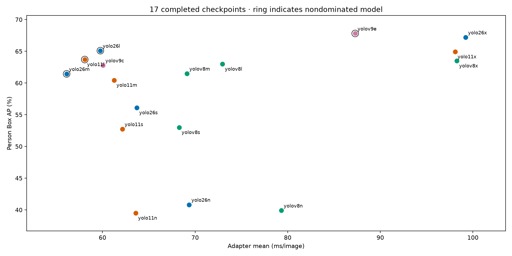

# YOLO Instance Segmentation — CCTV600 Scaling Study

**COMPLETE** ครบ 17 checkpoints ตัวละ 600 ภาพ GT เข้าเกณฑ์ 769 คน พร้อม 3 clean timing rounds ต่อโมเดล ใช้ pretrained, input 640, batch 1, FP32 บน Tesla T4 ประกอบด้วย YOLO26/YOLO11/YOLOv8 อย่างละห้าขนาด และ YOLOv9 ขนาด e/c รวม 17 checkpoints

## อ่านผลตามวัตถุประสงค์

| เอกสาร | ใช้อ่านเรื่องใด |
| --- | --- |
| [MASTER_RESULTS.md](MASTER_RESULTS.md) | ผลเต็ม 17 ตัว คุณภาพ/เวลา/VRAM กลุ่มข้อมูล และประวัติการตรวจปิดรอบ |
| [RESEARCH_INSIGHTS_TH.md](RESEARCH_INSIGHTS_TH.md) | คำถามข้ามขนาด scaling, Pareto, near-tie และการตีความ |
| [EXECUTIVE_SUMMARY_TH.md](EXECUTIVE_SUMMARY_TH.md) | ข้อเสนอการเลือกแบบสั้น |
| [MEETING_SUMMARY_TH.md](MEETING_SUMMARY_TH.md) | ลำดับนำเสนอพร้อมกราฟและข้อจำกัด |
| [METRIC_GUIDE_TH.md](METRIC_GUIDE_TH.md) | สูตร หน่วย denominator ขอบเขตเวลา และ schema ตาราง |
| [EXPERIMENT_PROTOCOL.md](EXPERIMENT_PROTOCOL.md) | เงื่อนไขที่ตรึงก่อนรัน |

## การนำทางทั้ง study

[Largest (X/E)](https://github.com/folklazy/YOLO_Large_Seg_CCTV600_Benchmark) · [Second-largest (L/C)](https://github.com/folklazy/YOLO_Second_Largest_Seg_CCTV600_Benchmark) · [Medium (M)](https://github.com/folklazy/YOLO_Medium_Seg_CCTV600_Benchmark) · [Small (S)](https://github.com/folklazy/YOLO_Small_Seg_CCTV600_Benchmark) · [Nano (N)](https://github.com/folklazy/YOLO_Nano_Seg_CCTV600_Benchmark) · [Master](https://github.com/folklazy/YOLO_Instance_Segmentation_CCTV600_Scaling_Study)

## ผู้ได้ผลดีที่สุดตามแต่ละเป้าหมาย

| ด้าน | โมเดล | ค่าที่วัด |
| --- | --- | --- |
| Box AP | yolov9e-seg.pt | 67.808 % |
| AP75 | yolov9e-seg.pt | 77.973 % |
| Recall | yolo26x-seg.pt | 81.144 % |
| Forward time | yolov8n-seg.pt | 9.923 ms/ภาพ |
| Adapter time | yolo26m-seg.pt | 56.126 ms/ภาพ |
| Adapter FPS | yolo26m-seg.pt | 17.817 ภาพ/วินาที |
| Allocated VRAM | yolov9c-seg.pt | 506.215 MiB |



## ตารางที่นำไปวิเคราะห์ต่อได้

- [MASTER_17_MODELS.csv](metrics/MASTER_17_MODELS.csv) เก็บค่าความละเอียดเต็มของทุก checkpoint
- [TIER_WINNERS.csv](metrics/TIER_WINNERS.csv) มีเจ็ดเป้าหมายต่อ tier แยก maximize/minimize
- [SCALING_DELTAS.csv](metrics/SCALING_DELTAS.csv) มี 13 คู่ติดกัน × 11 metrics ใช้ smaller−larger
- [PARETO_FRONTIER.csv](metrics/PARETO_FRONTIER.csv), [PARETO_PIPELINE.csv](metrics/PARETO_PIPELINE.csv), [PARETO_VRAM.csv](metrics/PARETO_VRAM.csv) แยกแกนต้นทุน
- [TIMING_COMPOSITION.csv](metrics/TIMING_COMPOSITION.csv), [TIMING_MASTER.csv](metrics/TIMING_MASTER.csv) และ [ACTIVE_600_TIMING.csv](metrics/ACTIVE_600_TIMING.csv) แยก component, distribution และเวลาใน quality pass
- [MODEL_COMPLEXITY_MASTER.csv](metrics/MODEL_COMPLEXITY_MASTER.csv) ให้ parameters, GFLOPs estimate และ checkpoint MB
- [PER_GROUP_RESULTS.csv](metrics/PER_GROUP_RESULTS.csv) ให้ day/night AP และ Recall ตามขนาด GT
- [PLOT_READY_RESULTS.csv](metrics/PLOT_READY_RESULTS.csv), [NEAR_TIES.csv](metrics/NEAR_TIES.csv) และ [NEAR_TIE_RESOURCE_DELTAS.csv](metrics/NEAR_TIE_RESOURCE_DELTAS.csv) รองรับการทำกราฟและอ่านคู่คะแนนใกล้กัน
- [RESULT_INDEX.json](metrics/RESULT_INDEX.json), [CLOSEOUT.json](metrics/CLOSEOUT.json) และ [PRESENTATION_REVISION.json](metrics/PRESENTATION_REVISION.json) ระบุ sources, hashes, membership และการปรับเอกสารครั้งนี้

## กราฟหลัก









กราฟ forward/FPS/VRAM scaling, parameters และ day/night/size อยู่ใน [metrics/plots](metrics/plots/) ส่วนแต่ละ tier มีกราฟมาตรฐานหกรูปพร้อมรายงานภาพ

## หลักฐานภาพ

แต่ละ tier มี PRESENTATION_SUMMARY_TH.md อธิบายกราฟ การเลือกกรณี และผลรวมชุดภาพประกอบ มี private comparison gallery สี่ภาพจาก fixed16 เดิมสำหรับเทียบ full frame/ROI และ matching ราย GT ครบทุกโมเดล ภาพ CCTV และข้อมูลระบุภาพคงเก็บในเครื่องตามนโยบายเดิม เปิด Master `outputs/presentation-20261116T094620918214Z/index.html` หรืออ่านดัชนีจาก PRESENTATION_REVISION.json

## รูปแบบที่นำมาจาก MOTS20

[ตารางเทียบ protocol และข้อจำกัดตามโค้ดที่ใช้จริง](METRIC_GUIDE_TH.md#protocol-comparison)

ตรวจ Master และทั้งห้า tier ของ [MOTS20 study](https://github.com/folklazy/YOLO_Instance_Segmentation_MOTS20_Scaling_Study) จริง รายการเอกสาร revision และ SHA256 ที่ตรวจอยู่ใน [presentation evidence](metrics/PRESENTATION_REVISION.json) นำบทบาท README/REPORT/RESULTS/PRESENTATION, เจ็ด winners, scaling, Pareto, stage composition และตัวอย่าง matching มาปรับกับข้อมูลชุดนี้

CCTV600 ใช้ Box AP กับ visible bbox ≥50 px และ rectangle-ignore union ส่วน MOTS20 มี GT person silhouettes และ Mask AP จึงต้องระบุชนิด metric และ dataset กำกับ ภาพจริงของ CCTV600 ใช้ private gallery ตามนโยบายเดิม รายละเอียดร่วมและส่วนต่างอยู่ใน METRIC_GUIDE_TH.md

## ตรวจสถานะและสร้างเอกสาร

จาก workspace เดิม

```bash
.venv/bin/python YOLO_Instance_Segmentation_CCTV600_Scaling_Study/analysis/closeout.py --status
.venv/bin/python YOLO_Instance_Segmentation_CCTV600_Scaling_Study/analysis/presentation.py --check
```

สร้าง derived presentation ใหม่จากผลเดิม

```bash
.venv/bin/python YOLO_Instance_Segmentation_CCTV600_Scaling_Study/analysis/presentation.py
```

คำสั่งสุดท้ายอ่าน canonical statistics กับ saved packets เฉพาะสี่ภาพต่อโมเดล เก็บ snapshot เอกสารเดิมใน private outputs และตรวจ hashes ของ accepted results ว่าคงเดิม การรัน `analysis/closeout.py` แบบสร้างรายงานเป็นการสร้างเอกสารรุ่นปิดรอบก่อนจัด presentation ให้ใช้ presentation.py ต่อท้ายหากต้องสร้างใหม่

## ขอบเขตการตีความ

GT inventory อ้างการตรวจรับ 600 ภาพโดยผู้จัดทำ dataset ยังไม่มีการทวนทุกคนอย่างอิสระ ไม่มี uncertainty analysis และ full-person GT silhouette สำหรับ Mask AP ผลเป็น checkpoint/configuration comparison บน CCTV600 โดย pretraining/capacity ต่างกัน Adapter FPS มีขอบเขตตามคู่มือตัวชี้วัด การนำไป deployment ต้องตรวจตามเงื่อนไขระบบปลายทาง
