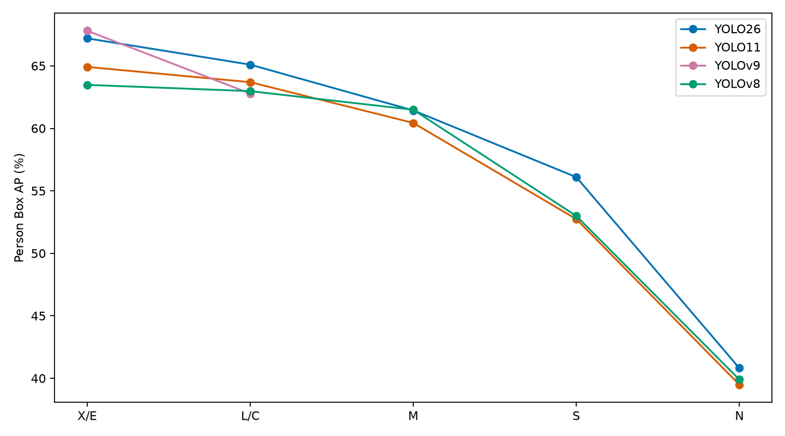
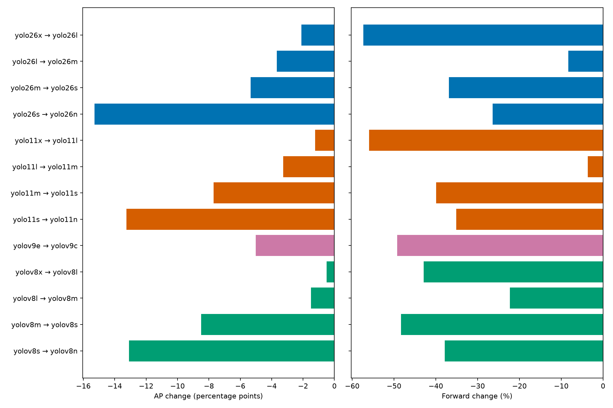
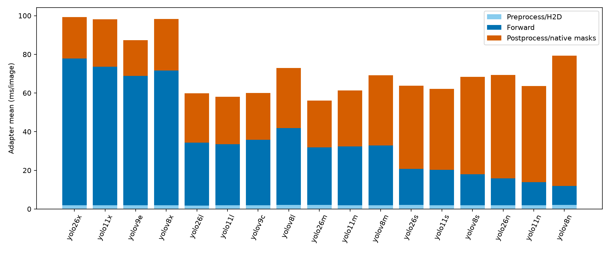
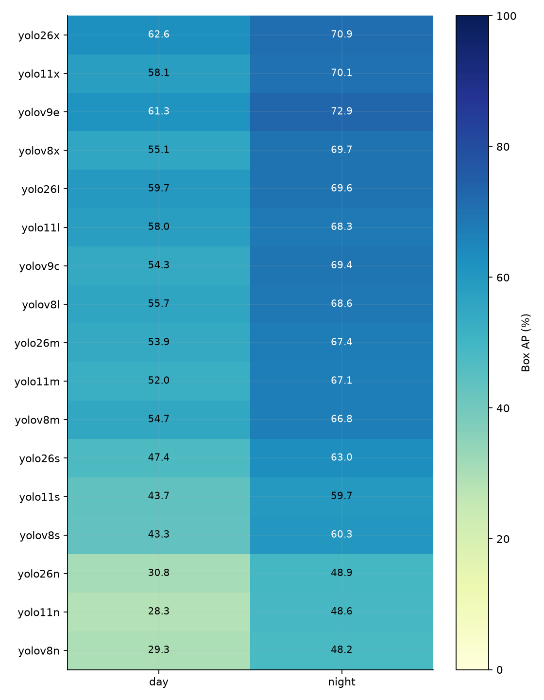
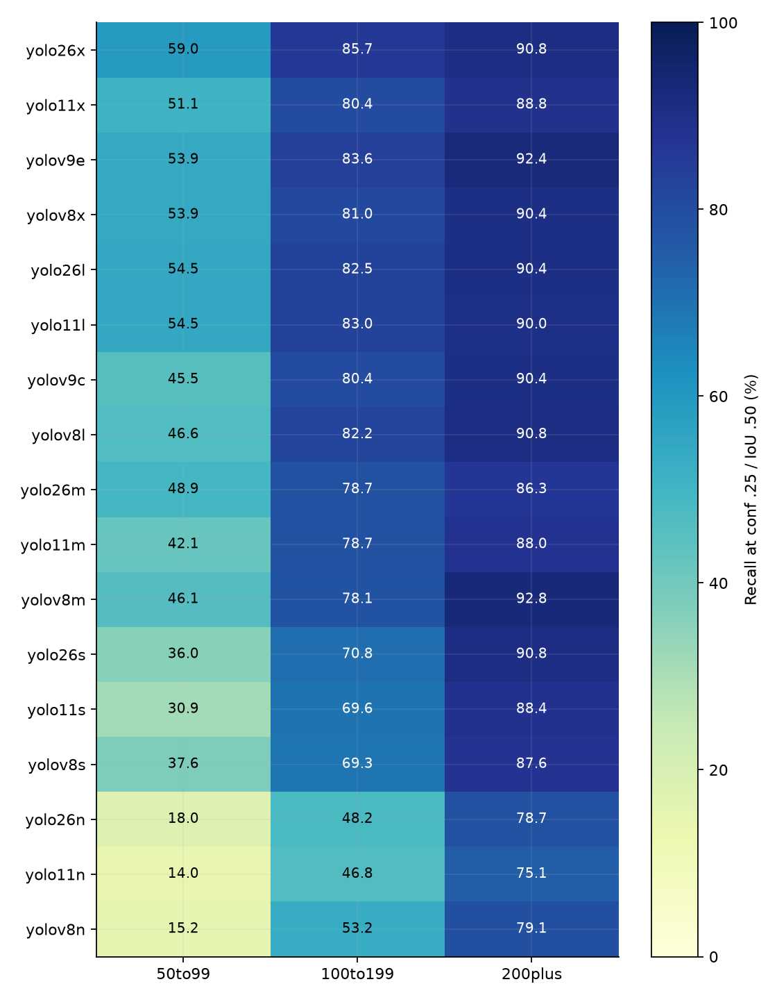

# วิเคราะห์ผล YOLO CCTV600 ข้ามขนาด

ครบ 17 checkpoints ตัวละ 600 ภาพ GT เข้าเกณฑ์ 769 คน พร้อม 3 clean timing rounds ต่อโมเดล ใช้ pretrained, input 640, batch 1, FP32 บน Tesla T4

## 1. ตัวนำคุณภาพและ coverage เป็นตัวเดียวกันหรือไม่

yolov9e-seg.pt มี Box AP 67.808% และ F1 85.356% ส่วน yolo26x-seg.pt มี Recall สูงสุด 81.144% ตัวแรกมี FP 53 / FN 157 เทียบกับ FP 113 / FN 145 ของตัวหลัง เป็นข้อแลกเปลี่ยนที่ operating point เดิม การเลือกโมเดลสำหรับส่งคนเข้า parser จึงต้องระบุว่าจะรับผลเกินหรือพลาดคนได้เท่าไร

## 2. ลดขนาดแล้วได้อะไร

YOLO26x → YOLO26l ทำให้ AP เปลี่ยน -2.102 pp, forward เปลี่ยน -57.36% และ adapter เปลี่ยน -39.76% ที่ค่าประเมินเดิม เป็นจุดพิจารณาต้นทุนหนึ่งจุด ยังไม่มีคะแนนถ่วงน้ำหนักที่ตัดสินว่าคุ้มสำหรับทุกงาน

### ส่วนต่างเมื่อเปลี่ยนจาก S เป็น N

| Family | AP change pp | Forward change % | Adapter change % | Allocated change % |
| --- | --- | --- | --- | --- |
| YOLO26 | -15.282 | -26.37 | 8.84 | 72.04 |
| YOLO11 | -13.247 | -35.11 | 2.33 | 18.99 |
| YOLOv8 | -13.088 | -37.87 | 16.15 | 5.54 |

ค่าทั้งหมดเป็น N−S ใช้ S เป็นฐานร้อยละสัมพัทธ์ การลด forward จึงอาจเกิดร่วมกับ adapter หรือ allocated peak ที่สูงขึ้นได้ งานหลัง forward และจำนวน retained masks เป็นส่วนของ workload ที่ต้องอ่านประกอบ โดยยังไม่สรุปสาเหตุจาก architecture

## 3. Forward เร็วขึ้นส่งผลถึง pipeline เพียงใด

yolov8n-seg.pt forward ต่ำสุด 9.923 ms/ภาพ แต่ yolo26m-seg.pt มี adapter ต่ำสุด 56.126 ms/ภาพ ความต่างของ native mask postprocessing ต้องอ่านจาก measured stage composition การอธิบายว่าเกิดจาก architecture โดยตรงต้องมีการทดลองแยกเพิ่ม

## 4. ตัวเลือกบน Pareto เปลี่ยนตามเป้าหมายอย่างไร

| แกนเปรียบเทียบ | Nondominated checkpoints |
| --- | --- |
| AP / forward | yolov9e-seg.pt, yolo26l-seg.pt, yolo11l-seg.pt, yolo26m-seg.pt, yolov8m-seg.pt, yolo26s-seg.pt, yolov8s-seg.pt, yolo26n-seg.pt, yolov8n-seg.pt |
| AP / adapter | yolov9e-seg.pt, yolo26l-seg.pt, yolo11l-seg.pt, yolo26m-seg.pt |
| AP / allocated VRAM | yolo26x-seg.pt, yolov9e-seg.pt, yolo26l-seg.pt, yolov9c-seg.pt |

ใช้ dominance จากสถิติเต็มก่อนปัดเศษ แต่ละ frontier ตอบวัตถุประสงค์สองแกน ค่า allocated ต่ำสุดรวมเป็น yolov9c-seg.pt ที่ 506.215 MiB และยังต้องรวม CUDA context/บริการอื่นเมื่อประเมิน deployment memory

## 5. Near-tie ในกลุ่ม M

YOLOv8m มี AP สูงกว่า YOLO26m เพียง 0.052 pp ส่วน Recall และ resource ต่างกัน ค่าที่ต่างน้อยนี้เป็นการคัดกรองเชิงพรรณนา ยังไม่มี uncertainty เพื่อยืนยันความแตกต่างหรือ equivalence ตาราง [NEAR_TIE_RESOURCE_DELTAS.csv](metrics/NEAR_TIE_RESOURCE_DELTAS.csv) ระบุทิศทาง B−A และฐาน A ชัดเจน

| Model | Box AP % | AP75 % | Recall % | Forward ms/ภาพ | Adapter ms/ภาพ | FPS | Allocated MiB |
| --- | --- | --- | --- | --- | --- | --- | --- |
| yolo26m-seg.pt | 61.437 | 69.662 | 74.252 | 29.719 | 56.126 | 17.817 | 605.934 |
| yolov8m-seg.pt | 61.489 | 69.790 | 75.423 | 30.927 | 69.127 | 14.466 | 766.317 |

## 6. Day/night และขนาดคน

| กลุ่มขนาด | Pooled AP winner | Day AP winner | Night AP winner |
| --- | --- | --- | --- |
| Largest (X/E) | yolov9e-seg.pt | yolo26x-seg.pt | yolov9e-seg.pt |
| Second-largest (L/C) | yolo26l-seg.pt | yolo26l-seg.pt | yolo26l-seg.pt |
| Medium (M) | yolov8m-seg.pt | yolov8m-seg.pt | yolo26m-seg.pt |
| Small (S) | yolo26s-seg.pt | yolo26s-seg.pt | yolo26s-seg.pt |
| Nano (N) | yolo26n-seg.pt | yolo26n-seg.pt | yolo26n-seg.pt |

ผล day/night แยก metadata ที่มีอยู่ ภาพแต่ละกลุ่มมีสถานที่ มุม และจำนวนคนต่างกัน ความต่างจึงยังแยกสาเหตุด้านแสงไม่ได้ ส่วน size-band recall แสดงการเก็บ GT ที่ขนาดต่างกันภายใต้ matching เดิม AP รวมเป็น pooled AP ที่อ่านจาก canonical result โดยตรง

## 7. สิ่งที่หลักฐานภาพช่วยอธิบาย

ตรวจสี่กรณีต่อ tier จาก fixed16 เดิม รวม 20 comparison panels จากภาพต้นทางห้าภาพ มีทั้ง visible person ที่ถูกตัดขอบ คนหลังโครงสร้างบัง คนบนทางเดิน คนหลายขนาดร่วมกับ ignore และ negative frame พร้อมภาพเต็ม/ROI ตรงกันและ per-GT matching เทียบ canonical counts Case A/C/D ใช้ร่วมกันทุก tier ส่วน B ของ Small ใช้กรณีที่แยกผลโมเดลได้ แทนกรณีที่ทั้งสามตัวให้ counts เหมือนกัน

รายงานภาพของแต่ละ tier แยก FN ซึ่งอาจมี candidate ที่ IoU ไม่ผ่านออกจากการไม่สร้าง prediction และแยก FP จาก ignored predictions การดู mask รูปร่างใกล้คนไม่ได้รับรองว่าผ่านเกณฑ์ bbox หรือว่าขอบ mask ถูกต้องทั้งตัว ภาพจริงและ per-image IDs คงเป็น private

## 8. ขอบเขตคำอ้าง

ผลนี้เปรียบเทียบ pretrained checkpoint พร้อม configuration บน CCTV600 ยังไม่แยก architecture/pretraining causality, ไม่มี significance analysis และยังไม่มี GT silhouette สำหรับ Person Mask AP การรับรอง inventory อิงการตรวจรับของผู้จัดทำ dataset ทั้ง 600 ภาพ ยังขาด independent full-inventory adjudication

Adapter FPS มีขอบเขต preprocess/H2D + forward + postprocess/native masks/transfer ส่วน input I/O, RLE, write/load/warmup มี timer และขอบเขตแยก โมเดลที่ส่งกรอบให้ parsing ได้ดีต้องประเมิน parsing downstream เพิ่มในงานถัดไป

[รายงานหลัก](MASTER_RESULTS.md) · [นิยามตัวชี้วัด](METRIC_GUIDE_TH.md)
